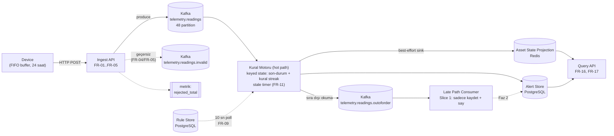

# High-Level Design — İlk Dikey Kesit

**Girdiler:** `02-requirements/functional.md`, `02-requirements/nfr-slo.md`, `03-capacity/bote-model.md`
**Kapsam:** telemetri ingest → stream processing → asset state → kural tabanlı uyarı.
**Bu doküman teknolojiden bağımsız olmayı hedefler**, ama BOTE üç yerde teknolojiyi zorunlu kıldı (Kafka'nın sıralı log'u, PostgreSQL'in aralık kısıtı, akış motorunun yönetilen state'i) — o yerler açıkça işaretli.

> **Revizyon 2026-11-27 (ADR-0003 sonrası):** §1, §2.3, §5, §7, §8 ve §9 değişti. Sebep bir tutarsızlık değil, bir **kelime karışıklığıydı**: bu doküman "state" ile iki farklı şeyi anlatıyordu — Asset'in son bilinen durumu ve kuralın streak'i — ve ikisini iki farklı bileşene koymuştu (Redis / consumer belleği). BOTE §2.4 ise ikisini **tek kalemde** toplamıştı (25 MB). Hesap birleşik, çizim ayrıydı. ADR-0003 state'i yönetilen bir akış motoruna aldığı an ayrımın yazılması zorunlu oldu ve iki sonuç çıktı: **Redis hot path'ten çıktı** (§5.3) ve **Stale Sweeper bileşeni ortadan kalktı** (§5.2). Eski gerekçeler silinmedi, §5'te "neden değişti" olarak duruyor.

---

## 1. Bileşenler ve akış



| Bileşen | Sorumluluk | Durum (state) |
|---|---|---|
| **Ingest API** | Doğrula, `ingest_time` damgala, Kafka'ya yaz, **broker ack'ini aldıktan sonra** cihaza ack dön | Stateless |
| **Kural Motoru (hot path)** | Asset son-durumunu güncelle, kuralları değerlendir, Violation → Alert, her okumada stale timer'ını yenile (FR-11) | **Yönetilen keyed state, ~25 MB** — iki tür, §5.1 |
| **Late Path Consumer** | Sıra dışı okumaları işle | Slice 1'de yok |
| **Asset State Projection** | Query API'nin okuduğu son-durum görünümü — **hot path'te değil** | Türetilmiş; kaybolursa akıştan yeniden kurulur (§5.3) |
| **Query API** | Canlı durum + Alert listesi | Stateless |

**Stale Sweeper bileşeni yok.** Önceki hâlinde vardı; son-durum state'i motorun içine girdiği an taranacak bir yer kalmadı ve iş key başına bir timer'a indi (§5.2).

**Reddedilen Reading'in yeri (FR-04).** Bu diyagram reddi başta yalnızca bir metrik olarak gösteriyordu; oysa FR-04 reddedilen verinin *"kaybolmamasını ve incelenebilir bir yere yazılmasını"* istiyor — metrik bir sensörün bozulduğunu sayar, hangi payload'ın neden reddedildiğini söylemez. Yer, ADR-0004 ile `telemetry.readings.invalid` topic'i olarak tanımlandı.

**Ingest ack'in anlamı (D-01):** ack, "Kafka'ya yazıldı ve `min.insync.replicas` kadar replikaya ulaştı" demektir; "işlendi" demez. Cihaz ack'i aldığında buffer'ından silebilir. Bu, dayanıklılık sınırının **Kafka'nın replikasyonu** olduğunu söylüyor — kural motorunun çökmesi veri kaybettirmez, sadece geciktirir.

---

## 2. Zaman modeli — bu tasarımın merkezi

Üç zaman damgası var ve üçü farklı iş yapıyor:

| Damga | Kim koyar | Ne için kullanılır |
|---|---|---|
| `event_time` | **Cihaz** (ölçümün yapıldığı an) | Kural değerlendirmesi, Alert'in iş anlamı, state ilerlemesi (FR-07) |
| `ingest_time` | **Ingest API** | Gecikme ölçümü, "geç mi geldi" kararı, SLI-01'in filtresi |
| `created_at` | **Alert store** | SLI-01'in üst sınırı (`created_at − event_time`) |

### 2.1 Ayrım: "geç" ile "sıra dışı" aynı şey değil

Gereksinim dokümanlarında ikisini aynı kelimeyle (*late data*) andık. HLD'de ayrışmak zorundalar, çünkü **maliyetleri bambaşka:**

| | Tanım | Ne zaman olur | Maliyeti |
|---|---|---|---|
| **Geç ama sıralı**<br/>*(late, in-order)* | `event_time` eski, ama o Asset için daha yenisi **henüz işlenmedi** | Kesinti sonrası cihazın 24 saatlik buffer'ını boşaltması | **Sıfır.** Hot path normal işler. |
| **Sıra dışı**<br/>*(out-of-order)* | `event_time`, o Asset için **zaten işlenmiş** bir okumadan eski | Retry, kısmi ack, cihaz saat düzeltmesi | Yüksek — geçmişin yeniden hesaplanmasını gerektirir |

**Bu ayrımı mümkün kılan şey C-03 (Asset ↔ Device 1:1) ve cihazın FIFO buffer'ı.** Tek cihaz, tek kuyruk, sırayla boşaltıyor — dolayısıyla 24 saatlik bir backlog hot path'e **sırayla** gelir. Asset state monoton ilerler, kurallar doğru değerlendirilir, üretilen Alert'ler `event_time`'ı geçmişe ait olduğu için **kendiliğinden geriye dönüktür.**

> **Sonuç: FR-13'ün (geriye dönük Alert) asıl senaryosu olan recovery burst, Slice 1'de hot path tarafından karşılanıyor.** Ayrı bir mekanizma gerekmiyor. BOTE'nin §2.5'te "hot path ile late-data path aynı consumer olamaz" sonucu yalnızca **sıra dışı** okumalar için geçerli — bu, BOTE'nin o maddesinin daraltılmasıdır.

### 2.2 Neden reorder buffer yok — L-01'in doğrudan sonucu

Sıra dışı okumaları doğru işlemenin standart yolu **reorder buffer**: okumaları W saniye bekletip `event_time`'a göre sıralayıp işlemek. Ama:

```
reorder buffer penceresi W  →  her okuma W kadar bekler  →  alarm gecikmesi ≥ W
L-01 = p99 ≤ 5 sn           →  W için ayrılabilen bütçe birkaç yüz ms
W = 30 sn (anlamlı bir pencere) →  L-01 altı kat ihlal edilir
```

**L-01 = 5 sn, anlamlı bir reorder buffer'ı yasaklıyor.** Yani hot path varış sırasıyla, bekletmeden işlemek zorunda. Sıra dışı okuma için tolerans **sıfır**.

Bu, kararın bedelini net bir cümleye indiriyor: *5 saniyelik alarm hedefini seçtiğimiz an, sıra dışı veriyi hot path'te işleyemeyeceğimizi de seçmiş oldum.*

### 2.3 Sıra dışı okuma ne oluyor

```
kural motoru, Asset'in keyed state'indeki last_event_time ile karşılaştırır
(aynı key, aynı operator — event başına uzak okuma yok, bkz. §5.1):

  reading.event_time >  last_event_time  →  normal akış (geç olsa bile)
  reading.event_time <= last_event_time  →  SIRA DIŞI:
        1. Asset state GÜNCELLENMEZ (FR-07)
        2. telemetry.readings.outoforder topic'ine yazılır
        3. metrik artar: outoforder_total{reason}
```

| Faz | Sıra dışı okumaya ne yapılır |
|---|---|
| **Slice 1** | Kaydedilir ve **sayılır**. Kural değerlendirmesi yapılmaz. Metrik görünür. |
| Faz 2 | Time-series store'dan Asset'in `[T0−pencere, T0+pencere]` aralığı sorgulanır, kural yeniden değerlendirilir, gerekirse geriye dönük Alert üretilir |

**Faz 2'ye ertelenmesinin sebebi bir tercih değil, bir bağımlılık:** sıra dışı bir okumanın ihlal üretip üretmediğine karar vermek için **o Asset'in o andaki komşu okumalarına** erişmek gerekir. Bu erişim `(assetId, zaman aralığı)` indeksli bir sorgu demek — yani time-series store. O da Faz 2 (BOTE §2.10).

Alternatifleri reddediyoruz: Kafka'yı 24 saat geriye taramak tek Asset için 36 milyon event okumak demek; aynı veriyi state'te tutmak BOTE §2.4(c) = 415 GB.

> **Kabul edilen bedel ve görünürlüğü:** Slice 1'de bazı ihlaller hiç alarm üretmeyecek. Bunun sessiz kalmaması için `outoforder_total` metriği dashboard'da ve `karar-haritasi.md`'de açık bir satır olarak duruyor. **Ölçülmeyen bir boşluk, kabul edilmiş bir bedel değildir.**

---

## 3. FR-12 ↔ FR-13 çözümü: Alert bir nokta değil, aralıktır

### 3.1 Çatışma

- **FR-12:** aynı Asset + kural için aktif Alert varken yeni Alert üretilmez (dedup).
- **FR-13:** geç gelen veri geriye dönük Alert üretir, ihlalin `event_time`'ını taşır.

Çatışma "aktif" kelimesinde: *aktif* processing-time'a göre mi tanımlı (şu an açık olan kayıt), event-time'a göre mi (ihlalin gerçekleştiği dönem)? Processing-time seçilirse 6 saat önceki bir ihlal, şimdiki açık Alert yüzünden bastırılır — **yanlış**, ikisi farklı olay. Event-time seçilirse soru çözülür.

### 3.2 Karar (H-01)

**Alert, `event_time` ekseninde bir aralıktır:** `(tenantId, assetId, ruleId, period)`. Dedup, "açık kayıt var mı" sorusu değil, **"bu ihlalin zamanı mevcut bir aralığın içine düşüyor mu"** sorusudur.

```
yeni Violation, event_time = T:

  T, mevcut bir Alert aralığının İÇİNDE   →  yut (yeni Alert yok)     ... FR-12
  T, mevcut aralığa KOMŞU (≤ tolerans)    →  aralığı genişlet         ... FR-12
  T, hiçbir aralığa değmiyor              →  YENİ Alert, period=[T,T] ... FR-13
```

Üç davranış da aynı tek kuraldan çıkıyor; özel durum yok.

**Komşuluk toleransı = kuralın duration penceresi** (referans senaryoda 2 dk). Keyfi bir sayı değil, kural modelinden türüyor: iki ihlal arasındaki boşluk duration penceresinden kısaysa kural anlamlı şekilde **sıfırlanamamış** demektir (`streak` yeniden kurulup tetiklenecek kadar zaman geçmemiştir). O boşluk ayrı bir excursion değil, aynı excursion'ın içindeki gürültüdür.

Sonucu: tolerans kural başına tanımlı, global bir sabit değil. Duration penceresi 10 dk olan bir kural 10 dk'lık boşlukları yutar; 30 sn'lik bir kural yutmaz. Bu, `fleetstream_alerts_created_total` metriğinin kural bazında yorumlanması gerektiği anlamına geliyor.

### 3.3 Bunu doğru yapan üçüncü özellik: replay güvenliği

Kritik sonuç şu: aralık modeli, **aynı okumanın tekrar işlenmesini kendiliğinden idempotent yapar.**

```
D-02: at-least-once → aynı Reading birden fazla kez işlenebilir
consumer restart / offset geri alma → aynı aralık yeniden üretilir
      → T zaten mevcut aralığın içinde → yutulur → duplicate Alert YOK
```

Bu olmasa, consumer'ı bir saat geriden başlatmak operatöre binlerce tekrar alarm göndermekle sonuçlanırdı. **D-02'nin (at-least-once) operasyonel olarak yaşanabilir olmasını sağlayan şey bu model.**

### 3.4 Mekanizma — çakışmayı veritabanına doğrulatmak

Hot path consumer (ve Faz 2'de late path consumer) aynı `(asset, rule)` için eşzamanlı yazabilir. Uygulama katmanında "önce oku sonra yaz" kontrolü yarış koşulu bırakır. PostgreSQL'in aralık kısıtı bunu tek satırda garanti ediyor:

```sql
CREATE EXTENSION IF NOT EXISTS btree_gist;

CREATE TABLE alert (
  id          bigserial PRIMARY KEY,
  tenant_id   uuid        NOT NULL,
  asset_id    uuid        NOT NULL,
  rule_id     uuid        NOT NULL,
  period      tstzrange   NOT NULL,   -- event-time aralığı
  state       text        NOT NULL,   -- Raised | Acknowledged | Resolved
  created_at  timestamptz NOT NULL DEFAULT now(),   -- processing-time, SLI-01 için
  EXCLUDE USING gist (
    tenant_id WITH =, asset_id WITH =, rule_id WITH =, period WITH &&
  )
);
```

`EXCLUDE ... WITH &&` ile **çakışan iki Alert aralığının var olması veritabanı seviyesinde imkânsız.** Yazma mantığı "genişlet, olmazsa ekle; kısıt ihlali gelirse yeniden oku ve genişlet" olur.

> *Teknoloji bağımlılığı:* bu mekanizma PostgreSQL'e özgü. BOTE §2.11 Alert deposu için zaten PostgreSQL diyordu (hacim 0,03/sn), dolayısıyla yeni bir karar değil — ama ADR'de "neden PostgreSQL" sorusunun ikinci gerekçesi bu satır oldu.

### 3.5 SLI-01 bu tablodan nasıl ölçülüyor

```
gecikme = alert.created_at − lower(alert.period)
filtre  = yalnızca (ingest_time − event_time) < 60 sn olan okumalardan doğan Alert'ler
```

İkinci satır, recovery burst sırasında üretilen geriye dönük Alert'lerin SLO'yu ihlal etmemesini sağlıyor (BOTE §2.8). Bu filtre için `alert` tablosunda `source_lag_sn` alanı tutulur — aksi hâlde SLI sorgusu okumaya geri gitmek zorunda kalır.

---

## 4. Alert yaşam döngüsü ve FR-15 (auto-resolve)

FR-15 Adım 1'de ⚠️ bırakılmıştı; kararı burada veriyoruz.

### 4.1 Karar (H-02): auto-resolve yalnızca **pozitif gözlemle**

```
Raised  --operatör--> Acknowledged  --+
   |                                  |
   +-------- pozitif gözlem ----------+--> Resolved
```

**Pozitif gözlem:** aynı Asset + kural için, kuralın duration penceresi kadar süre **boyunca eşiğin içinde** kalan okumalar gelmesi. O anda Alert `Resolved` olur ve `upper(period)` son ihlal okumasının `event_time`'ına kapatılır.

**Veri gelmemesi resolve değildir.** Bir Asset sessizleştiğinde sıcaklık ihlali kendiliğinden kapanmaz — çünkü kapandığına dair hiçbir kanıt yok. O durum ayrı bir Violation'dır (FR-11 Stale Asset). Bu, `Resolved` durumunun her zaman bir ölçüme dayanmasını garanti ediyor; compliance tarafında "neden kapandı" sorusunun cevabı var.

**`Acknowledged` manuel kalıyor** — operatörün gördüğünü sistem tahmin edemez. MTTA'nın (referans senaryoda 3 dk) ölçülebildiği yer de burası: `acknowledged_at − created_at`.

---

## 5. State modeli ve Stale Asset

### 5.1 "State" tek bir şey değil — iki tür, tek yer

Bu dokümanın ilk hâlindeki hata buradaydı: *state* kelimesi iki farklı şeyi anlatıyor ve ikisi iki farklı bileşene konuyordu. BOTE ise ikisini **tek kalemde** toplamıştı (§2.4: `100K × 7 × 16 B + 100K × 100 B ≈ 25 MB`).

| | İçeriği | Kim yazar | Kim okur | Boyut (BOTE §2.4) |
|---|---|---|---|---|
| **Asset son-durum state**<br/>*(FR-06, FR-07)* | `last_event_time`, `last_ingest_time`, lat, lon, speed, temp, humidity | kural motoru, her okumada | kural motoru (sıra dışı tespiti §2.3, stale timer §5.2); Query API **projeksiyon üzerinden** (§5.3) | 100 B × 100K ≈ 10 MB |
| **Kural değerlendirme state**<br/>*(B-02)* | kural başına `streak_start` + `fired` bayrağı | kural motoru, her okumada | yalnız kural motoru | 16 B × 7 × 100K ≈ 11 MB |

**Neden ikisi aynı yerde durmak zorunda:** ikisi de `assetId` ile keyed ve ikisi de **aynı event'in işlenmesi sırasında** okunup yazılıyor.

```
sıra dışı tespiti (§2.3)  →  last_event_time'ı event'in tam ortasında ister
kural değerlendirmesi     →  aynı anda streak_start'ı ister
birini dışarı taşımak     →  event başına uzak okuma  →  ~20.000 uzak okuma/sn
                          →  ve o store hot path'in sert bağımlılığı olur → A-03 ona bağlanır
```

ADR-0003 ⑤'i (*state uzak bir store'da — Redis*) tam bu gerekçeyle reddetti. Dolayısıyla "son durumu Redis'te, streak'i motorda tutmak" ⑤'in **yarısını** seçmek olurdu: bedelini (A-03'ün Redis'e bağlanması) ödeyip faydasını (processor'ın gerçekten stateless olması) almamak. İki state türünü ayırmak **kavramsal** bir ayrım; onları ayrı bileşenlere koymak **mimari** bir hata.

> **Karar (H-06): her iki state türü de akış motorunun yönetilen keyed state'inde durur.** Kalıcılık, rebalance ve restore ADR-0003'ün satın aldığı mekanizmalardır. Sonuç: **hot path'in Kafka dışında hiçbir veri bağımlılığı yoktur** — Alert yazımı hariç.

**Neden stale tespiti `ingest_time`'a bakıyor** (değişmedi): stale, *verinin gelmemesi* demek — bu bir processing-time olgusu. `event_time` kullanılırsa, 24 saatlik buffer'ını boşaltan bir cihaz "stale" görünmeye devam eder, çünkü işlediği veri eski. Yanlış sinyal olurdu.

### 5.2 Stale Asset (FR-11) — tarama değil, key başına timer

Önceki tasarım stale'i **periyodik taramayla** çözüyordu: Redis'teki 100.000 kaydı 30 saniyede bir tara, eşiği aşanlar için Violation üret. Asset başına timer tutmak *"aynı sonucu daha karmaşık şekilde üretir"* diye reddedilmişti.

**O ret, timer'ı kendimiz yazdığımız dünyaya aitti.** 100.000 timer'ı elle yönetmek — kurmak, üzerine yazmak, checkpoint'lemek, rebalance'ta devretmek — gerçekten taramadan karmaşıktır. ADR-0003 ile bu mekanizma satın alındı: key başına timer, akış motorunun kalıcılaştırılmış ve checkpoint'lenen primitifidir. Üstelik son-durum state'i motorun içine girdiği için **taramanın tarayacağı yer de kalmadı.**

```
her okumada:
  state.last_ingest_time = now
  timer'ı (now + stale_eşiği)'ne kur     # aynı key'in önceki timer'ının üzerine yazar

timer ateşlerse:
  o Asset'ten stale_eşiği boyunca okuma gelmedi  →  Violation(Stale Asset)
```

**Timer bir processing-time timer'ıdır, event-time değil.** Bu, §5.1'deki gerekçenin birebir karşılığı. Event-time timer kullanılsaydı mekanizma **tanım gereği çalışmazdı:** veri gelmeyen bir Asset'in watermark'ı da ilerlemez, dolayısıyla timer hiç ateşlemez. Veri gelmemesini, veriyle ilerleyen bir saatle tespit edemezsin.

| | Eski: 30 sn tarama | Yeni: key başına timer |
|---|---|---|
| Ek bileşen | Stale Sweeper (ayrı deployable) | yok — kural motorunun içinde |
| Okuduğu yer | Redis (100.000 key, 30 sn'de bir) | kendi keyed state'i |
| Gecikme | eşik + 0–30 sn | eşik + timer çözünürlüğü |
| Ek state | yok | key başına bir timestamp (~100K × 10'lar B — mertebe değiştirmez) |

#### Bunun ürettiği yeni failure mode: yanlış stale fırtınası

Processing-time timer duvar saatine bakar. Job 15 dakika ayakta değilse (deploy, çöküş, rescale), restore anında **tüm Asset'lerin timer'ı geçmişte kalmış** olur ve hepsi birden ateşler — oysa veri kaybolmadı, Kafka'da bekliyor ve backlog henüz tüketilmedi. 100.000 Asset için tek seferde 100.000 Stale Alert: hem operatör ekranı hem §2.11'in *"0,03 Alert/sn"* varsayımı çöker.

> **Koruma: consumer lag eşiğin altına inene kadar stale üretimi bastırılır.** Lag yüksekken ateşleyen timer Violation'a çevrilmez, yalnızca `fleetstream_stale_suppressed_total` artar. Gerekçe §5.1'in gerekçesinin aynısı: lag yüksekken `last_ingest_time` *"veri gelmiyor"*u değil *"biz yetişemiyoruz"*u gösterir — sinyal o anda **yanlış şeyi ölçüyor**. Bu, tarama tabanlı tasarımda var olmayan bir bedel; timer'ın karşılığında ödeniyor ve ölçülüyor.

**Granülerliğin bedeli (değişmedi):** L-01'in 5 sn'si **ölçüm kaynaklı** alarmlar için geçerli; Stale Asset'in eşiği doğası gereği dakikalar mertebesinde olduğundan timer çözünürlüğü ihmal edilebilir. Bu, L-01'in tüm alarm tiplerini kapsamadığının yazılı kabulü.

### 5.3 Asset State Projection — Query API'nin okuma yolu

Son-durum state'i motorun içinde olduğundan **Query API ona doğrudan erişemez** (FR-16, L-02 = p95 < 200 ms). Motorun kendi sorgulanabilir state arayüzüne bel bağlamak dashboard'u job'un yaşam döngüsüne bağlar — job restart'ı sorgu kesintisi olur. Çözüm: motor güncellenen son-durumu Redis'e **yazar**, Query API Redis'ten okur.

> **Karar (H-07): Redis, hot path state'i değil, türetilmiş bir okuma projeksiyonudur.** İçinde kaynak veri yok; kaybolursa akıştan yeniden kurulur.

**Kritik ayrıntı — sink back-pressure yaparsa Redis arka kapıdan hot path'e döner.** Akış motorunda yavaş bir sink, back-pressure zincirini yukarı taşır ve kural değerlendirmesini durdurur. O anda A-03 (%99,9) yine Redis'e bağlanmış olur: §5.1'de reddettiğimiz şeyin aynısı, bu kez dolaylı yoldan.

| Seçenek | Karar |
|---|---|
| **(1) Best-effort sink** — asenkron yazım, hata yutulur + metrik; Query API bayat veri gösterir | **Seçildi** |
| (2) Araya topic: motor → `asset.state` topic → projeksiyon consumer'ı → Redis | Reddedildi: tam izolasyonun fiyatı bir topic + bir deployable. Projeksiyonun SLO'su A-02 (%99,5 — en gevşek hedef) ve kaybı tazelik, veri değil. |

(1)'in sonucu: **Redis kesintisi Alert üretimini durdurmaz**, yalnızca Query API'yi etkiler (A-02, L-02). §2.9'un *"Redis bir kapasite kararı değil"* sonucu böylece ayakta kalıyor — ama gerekçesi değişti: artık "pod'lar arası paylaşılan state" değil, "türetilmiş görünüm".

**Ölçülmeyen boşluk olarak kalan:** projeksiyonun **tazeliğinin** SLO'su yok. L-02 sorgunun *hızını* ölçüyor, verinin *yaşını* ölçmüyor — Query API 150 ms'de 40 saniyelik bayat veri döndürebilir ve hiçbir SLO ihlal edilmez. Kapatmıyorsak en az ölçüyoruz: `fleetstream_projection_lag_seconds` (sink'in yazdığı son `ingest_time` ile `now` farkı) dashboard'da duruyor, hedefi Adım 7'de ölçülen değere göre konacak. **Ölçülmeyen bir boşluk, kabul edilmiş bir bedel değildir.**

---

## 6. Kural dağıtımı (FR-09) — yeniden başlatma olmadan canlı güncelleme

```
Rule Store (PostgreSQL)  --10 sn poll-->  Hot path'in bellekteki kural cache'i
                                          (version kolonu değişmediyse cache korunur)
```

Push (Kafka üzerinden kural topic'i) yerine poll seçiliyor: 5-10 kural ve 10 saniyelik yayılma gecikmesi için push mekanizması kurmak, kazancı olmayan bir karmaşıklık. **Yayılma gecikmesi 10 sn** olarak kabul edilmiş bir sayıdır, FR-09'un "canlı" tanımı budur.

Kural değişikliğinin **geçmişe etkisi yok**: yeni kural yalnızca değişiklikten sonra gelen okumalara uygulanır. Aksi hâlde her kural düzenlemesi 90 günlük veriyi yeniden değerlendirmeyi tetiklerdi.

---

## 7. Graceful degradation sırası

Sistem yük altında kaldığında **hangi sırayla neyi feda edeceğimiz** şimdi yazılır, kriz anında değil. Sıralama doğrudan SLO tablosundan çıkıyor (A-03 ve D-01 en yüksek).

| Sıra | Feda edilen | Gerekçe |
|---|---|---|
| 1 | **Cold path yazımı** (arşiv/TSDB besleme) lag'e bırakılır | Faz 2 bileşeni, SLO'su saatler mertebesinde |
| 2 | **Sorgu API'si** rate limit'lenir (L-02/L-03 ihlal edilir) | A-02 = %99,5, en gevşek hedef; görünürlük kaybı, veri kaybı değil |
| 3 | **Asset state projeksiyonu** (Redis sink) seyrekleştirilir veya bırakılır | Türetilmiş görünüm; kaybı tazelik, veri değil. A-02 mertebesinde, hot path etkilenmez (§5.3'ün (1) seçimi) |
| 4 | **Ingest'te back-pressure + `Retry-After`** (B-07) | Cihaz buffer'ı yükü devralır → gecikme, kayıp değil. **D-03'ün 24 saati bu adımın bütçesi.** |
| 5 | **Hiçbir koşulda feda edilmez:** kural değerlendirmesi ve Alert yazımı | A-03 + D-01. Bu ikisi feda edilirse sistemin var olma sebebi kalmıyor. |

Eski listedeki *"Stale Sweeper aralığını 30 sn → 5 dk'ya çıkar"* adımı düştü: stale artık ayrı bir bileşen değil, kural motorunun timer'ı (§5.2) — ve motor 5. maddede feda edilmeyenler arasında. Yani stale, bir degradation düğmesi olmaktan çıkıp alarm pipeline'ının korumasına girdi.

4. adımın sırası önemli: **ingest'i kısmak, kural motorunu kısmaktan önce gelir.** Çünkü ingest kısıldığında veri cihazda bekler (kayıp yok); kural motoru kısıldığında ihlal kaçar (geri dönüşsüz).

---

## 8. Adım 4'e (ADR) taşınan kararlar

| # | Karar | Neden ADR gerekiyor |
|---|---|---|
| ADR-0002 | Time-series storage | BOTE §2.10: 156 milyar satır. §2.3'teki sıra dışı veri çözümü de buna bağlı. |
| ADR-0003 | Stream processing yaklaşımı | 25 MB state + event-time semantiği + replay. Kütüphane mi (Kafka consumer + kendi state'i), framework mü (Flink/Kafka Streams) — BOTE §2.6 "CPU problemi değil" dediği için seçim *state ve replay* ekseninde yapılacak. |
| ADR-0004 | Event streaming / log | **Adım 4'te eklendi.** Parametreleri B-04'te sabit (48 partition, RF 3, 7 gün) ama kararın kendisi kayıtsızdı. Bu dokümanın iki temel sonucu log'un garantilerine dayanıyor: §2.1 (*geç* ile *sıra dışı* ayrımı — cihaz FIFO'su + partition içi sıralama) ve §3.3 (replay güvenliği). Kayıtsız bir bağımlılık değil, ADR'si olan bir karar olmalı. |

> ADR-0002 ve ADR-0003 yazıldı; bu doküman ADR-0003 sonrası revize edildi (başlıktaki revizyon notu).

**ADR yazılmayacak olanlar** (gerekçesi BOTE'de kapandı): Alert deposu PostgreSQL (§2.11), serialization JSON (B-05), Analytics DB **TBD kalıyor** (B-10).

## 9. Bilinçli olarak tasarlanmayanlar

| Konu | Durum |
|---|---|
| Sıra dışı okumanın yeniden değerlendirilmesi | Faz 2 — TSDB bağımlılığı (§2.3). Slice 1'de **ölçülüyor**, çözülmüyor. |
| Çoklu kural tipi (ortalama, pencere) | Kapsam dışı — B-02 |
| Alert bildirim kanalları (e-posta, SMS, webhook) | Faz 2 — Alert'in *üretimi* kesit içinde, *dağıtımı* değil |
| Multi-tenant izolasyon | Kapsam dışı — C-02. `tenant_id` şemada ve partition key'de rezerve. |
| Projeksiyon tazeliğinin SLO'su | **Yok** — ölçülüyor (`fleetstream_projection_lag_seconds`), hedefi Adım 7'de konacak (§5.3). Bilinçli boşluk. |
| Yanlış stale fırtınası koruması için lag eşiği | Mekanizma karara bağlı (§5.2), **sayı değil** — eşik Adım 6'da ölçümle konacak. |
| Cihaz tarafı (jitter'lı reconnect, buffer yönetimi) | Adım 7'de **telemetri simülatörü** olarak yazılacak; gerçek firmware kapsam dışı |
