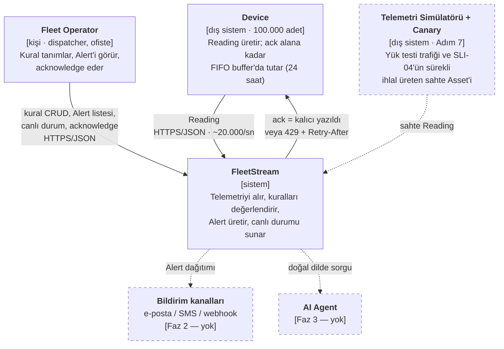
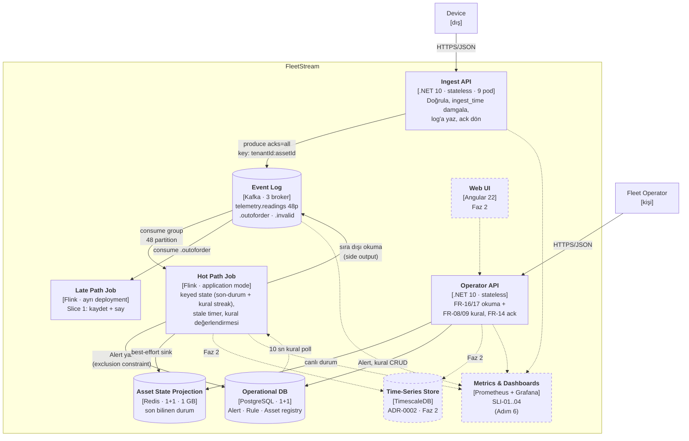

# C4 — Level 1 (Context) ve Level 2 (Container)

**Girdiler:** `04-design/hld.md` (revize), `05-adr/0002`–`0004`, `03-capacity/bote-model.md` §3, `02-requirements/*`
**Kapsam:** ilk dikey kesit (telemetri ingest → kural değerlendirmesi → Alert) ve onun etrafındaki sınırlar.

Bu doküman yeni bir tasarım yapmıyor; **HLD ve ADR'lerde verilmiş kararları sınırlara oturtuyor.** Değeri de burada: bir kutu çizmek, o kutunun deployable olup olmadığını, hangi SLO'yu taşıdığını ve kiminle hangi protokolle konuştuğunu söylemeye zorluyor. §4'te bu zorlamanın ürettiği beş karar var — ikisi HLD'de yazılı olmayan boşluklardı.

> **Level 3 (component) ve Level 4 (code) bilinçli olarak çizilmiyor.** Level 3'ün tek ilginç kutusu kural motorunun içi olurdu; ADR-0003 onun sınırını zaten tek cümleyle çizdi (*"kural mantığı akış motorundan habersiz saf bir fonksiyon: `(state, reading) → violation?`"*). Kod yazılmadan component diyagramı çizmek, çizgileri uydurmak olur. Adım 6'da gerekirse eklenir.

---

## 1. Level 1 — System Context



| Aktör / sistem | Yön | Not |
|---|---|---|
| **Device** | yazar | Sisteme veri yazan **tek** dış aktör. C-03 gereği Asset ↔ Device 1:1; FIFO buffer `hld.md` §2.1'in dayanağı. Cihaz yazılımı kapsam dışı. |
| **Fleet Operator** | okur + yazar | Yazdığı şeyler düşük hacimli ve insan hızında: kural tanımı (FR-08), acknowledge (FR-14). Slice 1'de arayüzü **API**; frontend Faz 2. |
| **Simülatör + Canary** | yazar | Adım 7'de yazılacak. **SLI-04 (A-03'ün ölçümü) buna bağlı** — bkz. §4.5. |
| Bildirim kanalları | — | Alert'in *üretimi* kesit içinde, *dağıtımı* değil (out-of-scope: Faz 2). |
| AI Agent | — | Faz 3. Cold path ve sorgu API'si olgunlaşmadan anlamsız. |

**Bu diyagramda bilinçli olarak olmayanlar:** Shipment/Trip ve ERP/TMS entegrasyonu (kapsam dışı — domain'i iki katına çıkarır), rota/ETA servisleri (farklı problem sınıfı), **ve bir kimlik sağlayıcısı.**

> **Kimlik doğrulama sınırı yok ve bu bir boşluk.** Out-of-scope dokümanı cihaz kimliğini *"verili kabul ediyoruz"* diyor, C-02 tenant bazlı auth'u kapsam dışı bırakıyor. Sonucu Level 1'de görünüyor: **100.000 cihaza açık bir ingest endpoint'i, önünde kimlik sınırı olmayan tek dış yüzey.** Yük testi için sorun değil; gerçek bir dağıtımda kapatılacak ilk şey bu. Kapsam dışı bırakılan bir şeyin diyagramda **boşluk olarak görünmesi**, listede satır olarak görünmesinden daha dürüst.

---

## 2. Level 2 — Container



| Container | Teknoloji | Sorumluluk | State | Ölçekleme sürücüsü | Taşıdığı SLO |
|---|---|---|---|---|---|
| **Ingest API** | .NET 10 | FR-01–05; `ingest_time` damgası; back-pressure + `Retry-After` (B-07) | yok | istek/sn (9 pod, tepede ×2 — B-06/B-08) | **A-01 %99,9**, SLI-02 |
| **Event Log** | Kafka, 3 broker | Dayanıklılık sınırı, key bazında sıra, 7 günlük replay, tüketici paralelliği | 2,4 TB × RF3 ≈ 7 TB | disk ve partition sayısı (ADR-0004) | D-01'in taşıyıcısı |
| **Hot Path Job** | Flink, application mode | FR-06/07/10/11/12/13 + H-01 dedup; stale timer (§5.2) | **yönetilen keyed state ~25 MB** | partition paralelliği (JM 2×1 + TM 3×2 vCPU) | **A-03 %99,9**, L-01, SLI-01/04 |
| **Late Path Job** | Flink, ayrı deployment | Sıra dışı okumaları kaydet + say (Slice 1); Faz 2'de yeniden değerlendirme | Slice 1'de yok | hacim nadir | **SLO yok — bilinçli boşluk** (B-03/H-03) |
| **Operator API** | .NET 10 | FR-16/17 okuma; FR-08/09 kural CRUD; FR-14 acknowledge | yok | dispatcher sayısı (~50) | **A-02 %99,5**, L-02, SLI-03 |
| **Asset State Projection** | Redis | Query için son-durum görünümü (H-07) | 30 MB, **türetilmiş** | 20.000 yazma + 5.000 okuma/sn (§2.9) | A-02'ye dahil |
| **Operational DB** | PostgreSQL | Alert (+ exclusion constraint), Rule, Asset registry | küçük (§2.11: 2.500 Alert/gün) | yok | A-03'e dahil — bkz. §4.4 |
| **Metrics & Dashboards** | Prometheus + Grafana | SLI-01..04 ve ADR'lerin erken uyarı sinyalleri | — | — | ölçümün kendisi (Adım 6) |
| *Time-Series Store* | TimescaleDB | Cold path (R-01/R-02) | ~3 TB | — | *Faz 2 — ADR-0002 **Öneri*** |
| *Web UI* | Angular 22 | Harita, grafik, Alert ekranı | — | — | *Faz 2* |
| *Analytics DB* | **TBD** | FR-19 agregasyon | — | — | *B-10: karar verecek sayı yok* |

**Bu bir deployment diyagramı değil.** k8s namespace'leri, node havuzları, ingress ve checkpoint depolaması Adım 6'da çizilir; buradaki "9 pod", "3 broker" gibi sayılar BOTE §3'ün mertebe tahminleri, dağıtım kararı değil.

---

## 3. Dikey okuma: bir Reading'in yolu

```
Device → Ingest API        doğrula (FR-04/05) → ingest_time → produce(acks=all)
                           ack ancak min.insync.replicas=2 sağlandıktan sonra döner (D-01)
     → Event Log           partition = hash(tenantId:assetId) → Asset'in sırası korunur
     → Hot Path Job        keyed state: last_event_time ile karşılaştır
                             event_time > last  → son-durumu güncelle, kuralları değerlendir,
                                                  stale timer'ı yenile
                             event_time ≤ last  → .outoforder topic'ine yaz + say (H-03)
     → Alert               Violation → H-01 aralık mantığı → PostgreSQL (exclusion constraint)
     → Projection          best-effort sink → Redis → Operator API → dispatcher ekranı
```

Bu zincir SLI-01'in ölçtüğü şeydir: `alert.created_at − lower(alert.period)`, p99 ≤ 5 sn — ve filtresi `ingest_time − event_time < 60 sn` (`hld.md` §3.5).

---

## 4. Diyagramın zorladığı beş karar

### 4.1 Hot path ve late path **ayrı** Flink deployment'ı (C4-01)

HLD ikisini "iki consumer" diye yazmıştı; container sınırı çizilince soru keskinleşti: aynı akış motoru cluster'ında iki job mu, iki ayrı deployment mı?

| Seçenek | Artı | Eksi |
|---|---|---|
| Tek session cluster, iki job | Tek JobManager, tek deploy hattı, kaynak paylaşımı | **Paylaşılan arıza alanı:** SLO'su olmayan bir job (late path), A-03 taşıyan job ile aynı JobManager ve aynı TaskManager slot'larını paylaşır. Late path'in OOM'u veya checkpoint hatası hot path'i etkiler |
| **İki application-mode deployment** *(seçildi)* | Arıza alanları ayrı; late path Faz 2'de ağırlaşsa (TSDB sorguları) hot path'i etkilemez; ölçekleme bağımsız | İkinci JobManager = ek operasyonel yük ve ek vCPU, 0,8 core'luk toplam iş için |

Gerekçe `hld.md` §7'nin mantığının aynısı: **SLO'su olan bir bileşen, SLO'su olmayan bir bileşenle arıza alanı paylaşmaz.** Degradation listesinde late path 1. sırada feda edilebilirken hot path 5. sırada *"hiçbir koşulda feda edilmez"* yazıyorsa, ikisi aynı process grubunda duramaz.

### 4.2 Ingest API ve Operator API ayrı container (C4-02)

İkisi de .NET; tek deployable yapmak daha az iş olurdu. Üç gerekçe ayırıyor:

1. **Farklı SLO:** A-01 %99,9 ile A-02 %99,5 aynı deployable'da birlikte tutulamaz — tek availability sınıfı olur, hem de yüksek olanı.
2. **Farklı ölçekleme sürücüsü:** 20.000 istek/sn ile ~50 dispatcher. Aynı pod'da ölçeklemek, sorgu trafiği için 9 pod çalıştırmak demek.
3. **`hld.md` §7'nin 2. degradation adımı:** *"Sorgu API'si rate limit'lenir"*. Aynı deployable'da bu cümle uygulanamaz — sorguyu kısmak ingest'i kısmak olur. ADR-0003 ①'in 3. gerekçesiyle aynı hata, bu kez API katmanında.

### 4.3 Operatör yazmaları için ayrı servis yok (C4-03)

FR-08/09 (kural CRUD) ve FR-14 (acknowledge) **yazma** işlemleri; "okuma API'si" adı onları dışarıda bırakıyordu. Ayrı bir admin servisi açmak yerine aynı container'a konuyor — hacmi insan hızında (dispatcher mertebesi), SLO'su aynı (A-02), bağımlılığı aynı (PostgreSQL). Bu yüzden container'ın adı **Operator API**: operatörün tek yüzeyi. Ayrı bir deployable, karşılığı olmayan bir sınır olurdu.

### 4.4 A-03'ün bağımlılık yüzeyi: Kafka + Flink + **PostgreSQL** (C4-04)

Oklar çizilince görünen şey: Alert yazımı PostgreSQL'e gidiyor, yani **A-03 (%99,9) üç bileşenin birleşimine bağlı.** `hld.md` §5.1 bunu *"hot path'in Kafka dışında veri bağımlılığı yok — Alert yazımı hariç"* diye yazmıştı; "hariç" kelimesinin bedeli burada ölçülüyor.

PostgreSQL kesintisinde ne olur:

```
Alert yazımı başarısız → Flink retry → checkpoint ilerlemez → back-pressure → consumer lag büyür
sonuç: Alert KAYBI yok (Kafka'da duruyor, offset ilerlemedi), Alert GECİKMESİ var
       → D-01 korunur, L-01 ihlal edilir
```

Bu, D-01 > L-01 öncelik sırasıyla (ve §7'nin mantığıyla) tutarlı: kayıp yerine gecikme. **Karara bağlanan şey, bunun kabul edilmesi:** Alert yazımı için ara tampon (outbox topic) veya PostgreSQL'i hot path'ten çıkaracak bir mekanizma **kurulmuyor** — çünkü §2.11'e göre hacim 0,03 Alert/sn ve ek bir tampon, H-01'in exclusion constraint'ini (aralık çakışmasını veritabanına doğrulatma) devre dışı bırakırdı. H-01 bu projede idempotency'nin tek gerçek mekanizması; onu bir tampon uğruna gevşetmek yanlış takas.

Yazılı sonucu: **A-03'ün SLO bütçesi üç bileşen arasında paylaşılıyor** ve PostgreSQL'in availability'si Adım 7'de ölçülecek kalemler arasına giriyor (H-08).

### 4.5 SLI-04'ün bileşeni yok (C4-05)

Level 1 çizilirken ortaya çıktı: **A-03'ün tek gerçek ölçümü (SLI-04 — canary Asset'in Alert yaşı) Slice 1'de var olmayan bir bileşene bağlı.** Canary, Adım 7'nin telemetri simülatörünün bir parçası olarak yazılacak; o zamana kadar A-03 için **uçtan uca sinyal yok**, yalnızca dolaylı göstergeler (consumer lag, back-pressure) var — ki `nfr-slo.md` zaten *"lag bu üç durumda da sağlıklı görünür"* diyerek bunların yetersizliğini yazmıştı.

Sonuç bir karar değil, bir **sıra** düzeltmesi: canary, Adım 7'nin load test aracının içinde değil, **Adım 6'nın observability işinin ilk parçası** olarak yazılır. Yoksa "A-03'ü ölçüyoruz" cümlesi load test gününe kadar doğru olmaz.

---

## 5. Karar haritasına eklenen satırlar

| # | Nereden çıktı |
|---|---|
| **H-08** | §4.4 — A-03'ün bağımlılık yüzeyi ve PostgreSQL kesintisindeki davranış |
| **H-09** | §4.1 — hot path / late path ayrı deployment |
| **H-10** | §4.5 — canary'nin Adım 6'ya alınması (ölçüm boşluğu) |

§4.2 ve §4.3 tabloya satır açmıyor: ikisi de mevcut kararların (A-01/A-02 ayrımı, §7'nin degradation sırası) doğrudan sonucu, yeni bir dayanak getirmiyorlar.

---

## 6. Sırada ne var

Adım 6 (dikey kesit kodu) bu diyagramdaki **dolu çizgili** kutuların tamamını kapsıyor; dashed olanlar kapsam dışı. Adım 6'ya bu dokümandan giren iki ek madde:

1. İki ayrı Flink deployment'ının CI/deploy hattı (§4.1).
2. Canary + SLI-04 enstrümantasyonu, load test aracından **önce** (§4.5).
